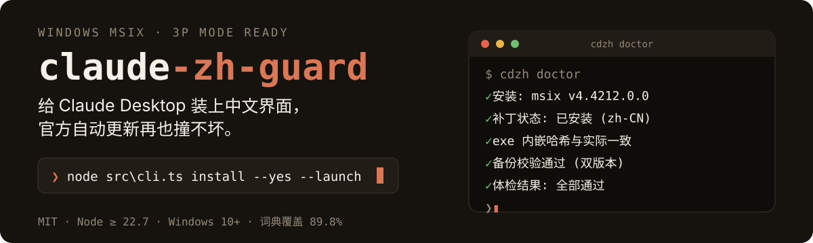
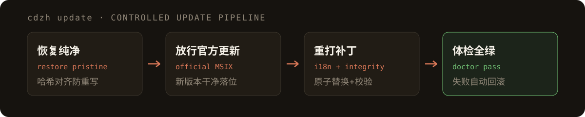

<p align="center">
  
</p>

**打不坏的 Claude Desktop 汉化管理器**——给微软商店版 Claude Desktop 装上简繁中文界面，并用备份、守护和自动回滚降低官方更新带来的风险。

    

## 为什么会有这个项目

Claude Desktop 的界面包 `ion-dist.asar` 被 [javaht/claude-desktop-zh-cn](https://github.com/javaht/claude-desktop-zh-cn) 等汉化方案改写后，官方后台静默更新的差量部署会发现哈希对不上、强制重写文件——写坏的那天，应用就永远卡在 *"Couldn't connect to Claude / ERR_UNEXPECTED"*（真机实录：`ion-dist.asar` 被写成 **0 字节**）。

claude-zh-guard 从架构上终结这个循环：**纯净备份在包外、更新走受控管线、坏了自己修回来**。你只管用中文界面，升级的事它管。

## 快速开始

要求：Windows 10+，[Node.js](https://nodejs.org) ≥ 22.7（原生运行 TypeScript，无需构建）。

```bat
node src\cli.ts doctor                  :: 先体检，看看现状（只读）
node src\cli.ts install --yes --launch  :: 装中文界面（自动备份，失败即回滚）
```

默认保留官方自动更新。官方更新落地后若界面变回英文，运行 `node src\cli.ts repair` 重打补丁；想彻底避免更新覆盖补丁，可加 `--disable-updates` 或运行 `updates off`。

以后想升级 Claude：

```bat
node src\cli.ts update    :: 恢复纯净 → 放行官方更新 → 自动重打补丁 → 重启
```

<p align="center">
  
</p>

日常还有两道保险：`doctor` 一键体检，`repair` 损坏自愈（从版本匹配的备份恢复并重打补丁）；`watch-task install` 注册开机守护后，官方更新落地会自动重打补丁。

## 和原方案比，强在哪

| | javaht/claude-desktop-zh-cn | claude-zh-guard |
|---|---|---|
| 重建方式 | 全量解包 4532 个文件再重打包 | 外科式流式重建，不落地临时文件 |
| integrity 块 | 有 | 有（实测 Claude 4.29+ 缺它=启动即崩溃） |
| 补丁面 | i18n + 3914 条硬编码替换（事故重灾区） | i18n 词典 + 语言白名单 + en-US 中文覆盖 + gated 消息精确兜底，缺词回退英文 |
| 备份 | 包内 `.zh-cn-backups`，复用最旧一份 | 包外按版本管理（ion-dist + app.asar + exe），哈希校验 |
| 官方更新 | 手动应对 | 默认保留；受控管线 + 守护自愈 + 可选禁更 |
| 出问题后 | 提示"可能不完整" | journal 事务自动回滚，`repair` 一键自愈 |

## 命令参考

<details>
<summary>全部命令与选项</summary>

```text
doctor                  只读体检：安装/补丁/哈希/备份/策略 全项检查
install                 安装汉化补丁（幂等；自动备份、失败回滚）
uninstall               卸载补丁，恢复官方纯净状态
repair                  自愈：损坏→备份恢复；版本变更→重打补丁
update                  受控官方更新管线
watch                   守护巡检（--interval 秒数；--no-auto-fix 只提醒）
watch-task install|uninstall   注册/注销开机守护计划任务
updates on|off|status   官方自动更新策略（默认保留，off 为可选加固）
dict check|sync         词典覆盖率 / 从上游仓库同步
launch                  MSIX 激活启动 Claude（启动前自检，损坏自动修复）
```

选项：`--lang zh-CN|zh-TW|zh-HK` · `--yes` · `--launch` · `--disable-updates` · `--elevate`
</details>

## 工作原理

Claude 前端有正规的 i18n 系统：运行时加载 `/i18n/<语言>.json`，缺失键回退英文；Claude 4.23118 起主进程菜单还从 `app.asar` 内的 `resources/i18n` 读词库。补丁做六件事：

1. 向 `ion-dist.asar` 追加 `i18n/zh-CN.json`（+ dynamic/statsig 覆盖层）
2. **把中文词库合并覆盖进 `i18n/en-US.json`**——官方 4.29+ 固定按 en-US 加载，且渲染进程约 1 秒后会把 locale 写回 en-US，只加 `zh-CN.json` 不会生效
3. 在界面 JS 的语言白名单里插入 `"zh-CN"`，并补语言选择器的中文名称
4. **本地化 gated 消息**：Claude 5.x 有一批只在 JS `defaultMessage` 里、不在本地词库中的消息；用现有词典与上游硬编码表做精确英文匹配，把兜底文案换成中文
5. 就地改写 `app.asar`（保留 6 个 unpacked 原生模块/exe 条目），把桌面词库合并进 `resources/i18n/en-US.json` 并补 `resources/i18n/zh-CN.json`，让原生菜单栏也显示中文
6. 补全 per-file integrity 块（**实测 Claude 4.29+ 没有它启动即崩**），同步 `Claude.exe` 内嵌的 `ion-dist.asar` 与 `app.asar` 头部哈希

备份会同时保存 `ion-dist.asar`、`app.asar` 和 `Claude.exe`，失败或卸载时三件一起还原。诊断脚本（asar 哈希探测、崩溃转储解析、未汉化审计）在 [`scripts/`](scripts/)。

## 词典与致谢

界面词典来自 [javaht/claude-desktop-zh-cn](https://github.com/javaht/claude-desktop-zh-cn)（MIT），简繁繁体（zh-CN/TW/HK）三套齐备，见 [NOTICE](NOTICE)。`dict sync` 会浅克隆并同步上游最新词典，`dict check` 查看三套词库（前端 / dynamic / 主进程）对当前版本的覆盖率（6.6395 实测：前端 82.8%、dynamic 100%、主进程 100%）。上游未覆盖的 gated 消息由 `hardcoded-zh-*.json` 精确英文匹配 + `extra-zh-CN.json` 人工补充兜底，6.6395 实测本地化 5.1 万处（51,801 处） `defaultMessage`；ICU 占位符不一致或同一英文存在多种译法时跳过，避免运行时报错或误译。主进程缺失词条由 `desktop-extra-zh-CN.json` 补齐。

## License

[MIT](LICENSE) © claude-zh-guard contributors。补丁会修改应用包内文件并重写 `Claude.exe` 内嵌哈希（签名状态改变），仅限个人设备自用，请遵守 Anthropic 服务条款。
